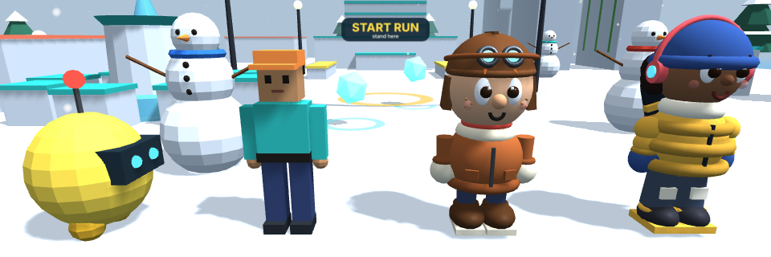
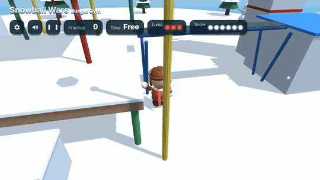
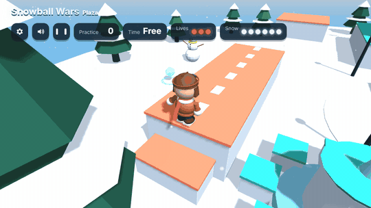
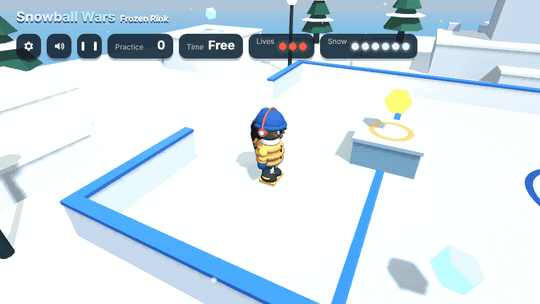
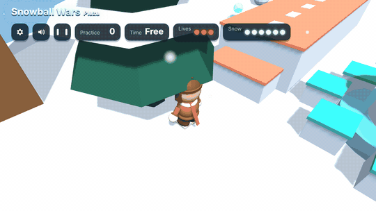
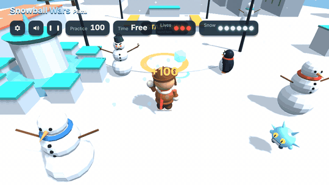

# Snowball Wars

### [▶ Play Snowball Wars](https://damonsea.github.io/snowball-wars/)

A 3D winter trick-platformer for the browser, starring Flip the stunt pilot and Nova the snowboarder. Chain flips, dives and wall jumps
into combos in Trick Park (Plaza, Frozen Rink, Rooftops, Jungle Gym), discover named gaps, have snowball fights, or play
the Adventure levels. Built with three.js; open `index.html` in a browser to play (multiplayer works only in the
claude.ai version).

**What's new:** see the [changelog](CHANGELOG.md).

## Features

### A cast with a real moveset
Pick **Flip** the stunt pilot or **Nova** the snowboarder for the full acrobat moveset, or **Sunny** (a bouncy robot)
and **Rook** (a quick explorer) for simpler controls. Flip and Nova each have five outfits; Golden Ace / Gold Rush
unlocks by beating Sky Gauntlet.

Double and triple jumps, a skid into a side somersault, backflips, long jumps, dives, wall jumps, a ground pound and
**Pound Jump** (Jump right after a ground pound to rocket straight up), plus **ledge hang**: grab edges as you fall past,
shimmy along them and pull up. Everything chains into combos.

### Trick Park
Four maps to skate, flip and wall-jump around, with free roam until you step on the START pad for a 60-second
scored run. Higher orbs are worth more, combos multiply, and **named gaps** reward clean lines.
- **Plaza:** a skatepark built around trick lines: tower and crown, runway, chimney, pillars, treehouse, fountain.
- **Frozen Rink:** real ice physics: build speed, glide, drift and bounce off the boards.
- **Rooftops:** a vertical city made for wall jumps, topped by a climbable antenna 18 m up.
- **Jungle Gym:** one connected playground built to use every move: a two-level fort, tire run, fireman pole,
  monkey bars, Pound Peak, trampolines and a wall-jump canyon, with 12 named gaps.

### Climb trees and poles
Run into a tree, lamp post or antenna to grab on, climb to a handstand, aim with the glowing arrow and flip off.

### Snowball fights
Throw snowballs (F / R1 / touch) at friends, snowmen and enemies. A hit knocks the target back and stuns it with
dizzy stars; orbs refill your snowballs. Turn on the **computer player** in Settings for someone to fight solo.
Optional silliness: hold the Ground pound button while standing for **yellow snow** (and a yellow snowball). Nova doesn't.

### Winter activities
- **Snow angels:** Crouch + Ground pound while standing in snow (Nova: just Ground pound). Lie back, sweep, leave an angel.
- **Rolling snowballs:** walk into one of the small snowballs around each Trick Park map to push it. It grows as it rolls,
  bowls over enemies and snowmen, and a big one is something to stand on. Smash it to start over.

### The winter crew

- **Snow goons** keep their distance and lob snowballs.
- **Penguin sliders** flap a red "!" and belly-slide at you, then sit dizzy.
- **Frost imps** steal your snowballs; smack them before they escape.

Punch, kick, snowball, dive, ground-pound or **stomp** them. Prefer the classics? Settings → Enemies → Spikeballs.

### Map Builder
Build your own Trick Park maps: Trick Park → **More maps & builder** (or **Map Builder** on the main menu).

- **Asset library:** blocks, walls, raised decks, monkey bars, stairs, tire stacks, ice, trampolines, climbing poles,
  lamp posts, trees, rocks, orbs, snowman targets, rolling snowballs and the START pad.
- **Edit:** click to place, drag to move, then resize, raise, recolor, rotate, duplicate or delete in the inspector.
  Undo/redo, keyboard shortcuts, and drafts that save as you go.
- **Test:** play the map with the full moveset, then pause → Back to builder.
- **Publish** (claude.ai version): the map joins the More maps list for everyone who opens the game.
  Anywhere else, **Export / Import** map files.

### Adventure
Hand-built levels with cores to collect, checkpoints and a goal: **Lighthouse Isles**, and **Sky Gauntlet**, which
needs Flip's or Nova's full moveset (and guard rails help).

### Play your way
- **Multiplayer** (in the claude.ai version): play Trick Park with friends, with shared orbs and enemies, name tags and trick callouts.
- **Controls:** keyboard & mouse, PS5 / standard controllers and touch; rebind anything in Settings → Controls.
- **Settings:** Winter or Summer look, snowfall, a sound style for every move, music, ambience and volume mix, enemy style, side flip style.

## Project guide

(Formerly "Orb Run", then briefly "Frosty Falls". Saved data keeps its `orbRun…` storage keys so scores, gaps and unlocks carry over.)

A 3D browser game built on three.js r128. Flip, a pint-sized stunt pilot, tricks his way
through Trick Park (three maps, free roam and timed runs, multiplayer) and Adventure (two levels).

## How the files fit together

The page loads plain scripts in order (see `index.html`). Each file can use anything defined
by files above it. Nothing is bundled.

| Order | File | What it does |
|---|---|---|
| 1 | `js/tuning.js` | **Every gameplay number**: gravity, jumps, speeds, ice, climbing, attacks, combo, scoring, camera |
| 2 | `js/core.js` | Renderer, scene, lights, material helpers, season registry, trees/rocks/flowers |
| 3 | `js/characters.js` | Sunny, Rook, Flip and Nova rigs, their wardrobes, character table |
| 4 | `js/fx.js` | Spikeball model, particle bursts, collision push-out |
| 5 | `js/audio/sfx.js` | Sound engine and the configurable sound-effect library |
| 6 | `js/audio/music.js` | Music tracks, ambience, spikeball rolling sound |
| 7 | `js/enemies.js` | Enemies: snow goons, penguin sliders, frost imps (AI, stomps, theft) and the Spikeballs toggle |
| 8 | `js/levels/engine.js` | Level/map builders and collision queries (how to add maps is documented at the top) |
| 9 | `js/levels/*.js` | Adventure levels: Lighthouse Isles, Sky Gauntlet |
| 10 | `js/maps/*.js` | Trick Park maps: Plaza, Frozen Rink, Rooftops, Jungle Gym |
| 11 | `js/content-ready.js` | Picks the current level and map once all are registered |
| 12 | `js/state.js` | Game state, HUD, menus, character select, pause |
| 13 | `js/trickpark.js` | Trick Park: START pad, combos, orbs, spikeballs, timed runs |
| 14 | `js/physics.js` | Platform physics, ice, walls, tree and pole climbing, ledge hang, trampolines, raised decks |
| 15 | `js/adventure.js` | Adventure: cores, checkpoints, tutorial zones, goal |
| 16 | `js/combat.js` | Three-hit combo, sweep, air kick |
| 17 | `js/movement.js` | Sunny/Rook controls and Flip's whole moveset |
| 18 | `js/pound.js` | Ground pound for every character: spin, drop, shockwave |
| 19 | `js/input/bindings.js` | Custom controls: key, mouse and controller bindings, rebinding in Settings |
| 20 | `js/ui/settings.js` | Settings panel (season, mix, sound styles) |
| 21 | `js/ui/controls.js` | Controls card, keyboard, touch |
| 22 | `js/input/gamepad.js` | PS5 / standard controller support |
| 23 | `js/loop.js` | The frame loop: update, animate, camera, render |
| 24 | `js/seasons.js` | Snowfall, breath, Winter/Summer switching |
| 25 | `js/multiplayer.js` | Trick Park multiplayer over the page's room capability |
| 26 | `js/snowballs.js` | Snowball fights: throwing, ammo (refilled by orbs), snowmen, hits on players (Trick Park only) |
| 27 | `js/yellowsnow.js` | Yellow snow: hold-to-spray stream that marks the snow, yellow snowballs (Settings → Yellow snow) |
| 28 | `js/winterfun.js` | Snow angels and rolling snowballs that grow |
| 29 | `js/cpu.js` | Computer player for Trick Park (Settings → Computer player) |
| 30 | `js/builder/maps.js` | Map Builder asset library, map cleaning, and turning a saved map into a playable Trick Park map |
| 31 | `js/builder/editor.js` | Map Builder editor: top-down camera, placing, selecting, dragging, inspector, undo, test play |
| 32 | `js/builder/community.js` | Drafts, publishing to the shared map list, More maps panel, export and import |
| 33 | `js/main.js` | Startup |

## Tests

`tests/` holds a headless playthrough. `three-stub.js` stands in for three.js with real vector
math and no rendering; `run.py` (needs Python, Playwright and Chrome) loads the game, makes randomness,
frame timing and audio deterministic, plays a scripted session through every mode and records
game-state snapshots. Run it on two versions and compare the snapshots to prove a change didn't
alter gameplay: `python3 tests/run.py index.html out.json`.
The stand-in library is swapped in for the CDN copy of three.js automatically.

Note: the downloaded single page no longer runs on its own. Play from the artifact page.

`lines.py` checks map design with the real physics: it places Flip at a spot, feeds frame-exact
inputs (held jumps, crouch timing, late dives, a wall-jump bot) and reports where he lands and which
named gaps fired. Use it whenever a map changes: each line should land, and each shortcut should not.

## Named gaps

A Trick Park map can list `gaps` in its `RUNMAPS` entry: `{name, pts, from:[regions], to:[regions]}`,
where a region is a box `{x,z,w,d,y}` at a surface height. Taking off from a `from` region and landing
in a `to` region without touching anything in between awards the gap into the combo. First discoveries
are saved per map and counted in the pause menu. Plaza has 13; Frozen Rink and Rooftops have none yet.

`snowballs-check.js`, `ammo-check.js`, `cpu-check.js`, `moves-check.js` and `nova-check.js` are quick checks of snowball hits, orb refills,
the computer player, and ground pound / rebinding / pole climbing: pass a file's contents as the second argument,
e.g. `python3 tests/lines.py index.html "$(cat tests/moves-check.js)"`.

