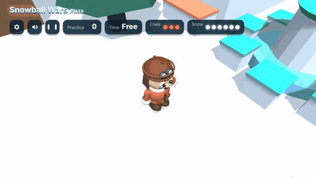
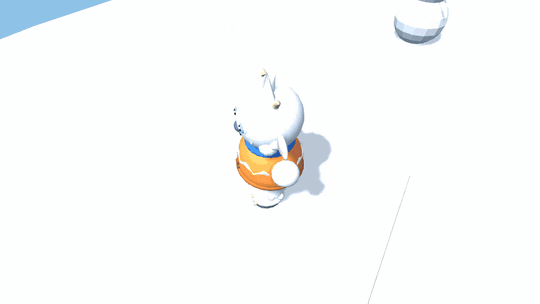
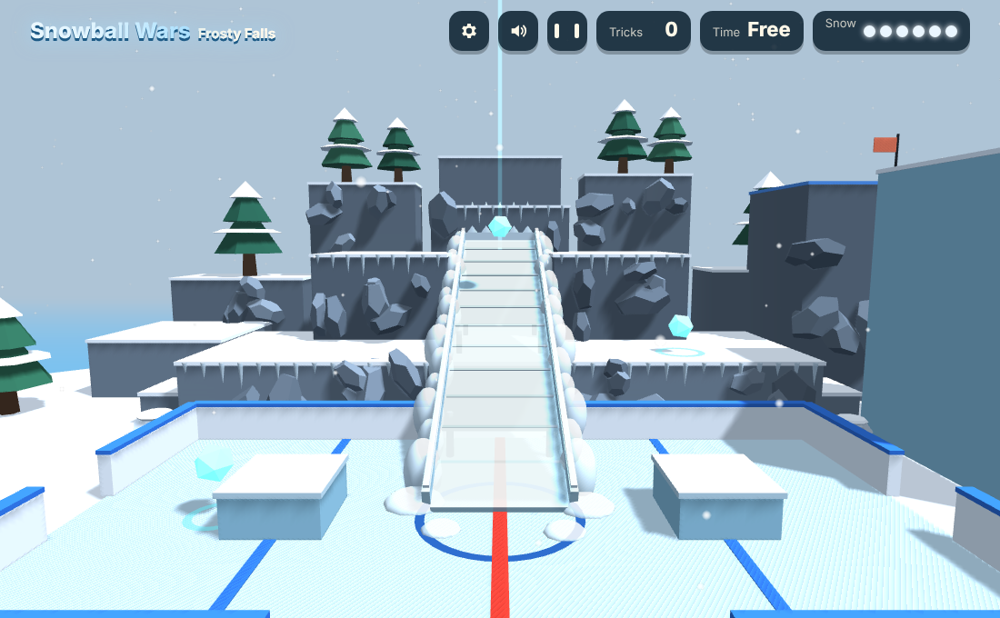
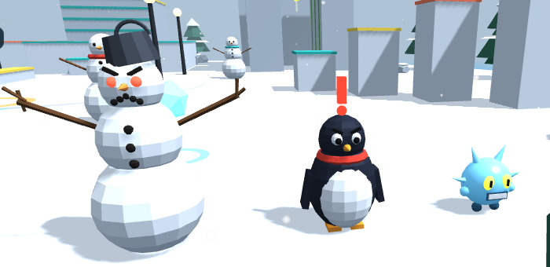

# Snowball Wars

### [▶ Play Snowball Wars](https://damonsea.github.io/snowball-wars/)

A 3D winter trick-platformer for the browser. Flip, dive, wall-jump and butt-slide around Trick Park, discover named
gaps, start a snowball fight with friends, or build your own maps. Built with three.js r128 as plain scripts: open
`index.html` in a browser to play. Multiplayer works in the claude.ai version and, peer-to-peer, on GitHub Pages.

**What's new:** see the [changelog](CHANGELOG.md).

## The cast

Pick **Flipper** the stunt pilot, **Parker** the backcountry snowboarder or **Tucker** the yeti cub. All three share
one moveset and the same speed and jump, so the choice is about who you like.

- **The moveset:** double and triple jumps, a skid into a side somersault, backflips, long jumps, dives, wall jumps,
  ground pound and **Pound Jump**, **ledge hang** (grab edges as you fall past, shimmy, pull up), tree and pole
  climbing with handstand flips off the top, and **butt-slides** down any slope. Moves chain into combos.
- **Characters with life:** Parker's slouchy beanie and pom-pom swing as she runs; Tucker's ears, curl of fur and
  scarf are on springs, his belly jiggles when he lands, and if you leave him alone he catches snowflakes on his tongue.
- **Squash & stretch** (Settings → Game) is a slider from Default to Max for a full cartoon feel.

### Customize
**Customize** on character select (or **Edit character** in the pause menu) opens a dressing room:
- **Outfits** to start from, and a color for every part.
- **Face** (Flipper and Parker): eyes, brows, mouth and nose shapes; eye whites, shine, freckles and blush on or off.
- **Wear:** cap, goggles, shoes and a **hoodie** (regular or oversized) for anyone. **Body type:** Stout or Slender.
- **Accessories** by slot, each in its own color: flaming head, aviator cap, winter hat, party hat, propeller cap, cat
  ears, halo, shades, specs, clown nose, headphones, scarf, snowboard and cape. They move too: propellers spin,
  flames flicker, hats and scarves swing.
- **Undo** and **Surprise me** on every tab. Friends see your look in multiplayer.

## Trick Park

Three maps, each built to the measured moveset: every gap is sized so a specific move makes it.

- **Frosty Falls:** a frozen waterfall pours off a rocky cliff onto a skating rink. Butt-slide down the falls, climb
  the cliff tiers to the Crown, hop Over the Falls, wall-jump the icy chimney to the Sky Deck, long-jump + dive off
  the Runway to the Perch, plus a treehouse, frozen fountain, candy canes, pillars, the Big Slide and a giant pine.
- **Woodsy Cabin:** an old log cabin in a pine forest. Start by a crackling campfire, climb the woodpile and porch to
  the roof and the smoking chimney, leap from the treehouse, take the stump stairs to the lookout, bounce on the
  tents, skate the frozen pond.
- **Christmas Village:** a rooftop loop around a town square: climb the giant tree and flip onto the clock tower,
  wall-jump up Chimney Alley, hop the bouncy market-stall awnings, and long-jump + dive off the sledding hill.

**Free roam** has no lives and no timer. Settings → **Trick points** (off by default) turns on combo scoring with a
multiplier. **Named gaps** (19, 8 and 12 per map) are found as you play and counted in the pause menu.

### Game modes
Press **Enter / △** in free roam, or pause → **Play**:
- **Collectathon:** how many orbs can you grab before time runs out? Friends on the map join in; a snowball hit knocks
  orbs loose. Solo, computer rivals race you (Settings → Collectathon rivals).
- **Snowball Wars:** a 3-minute free-for-all, 3 hearts each, most KOs wins. Snowball piles to restock, and
  **power-ups**: **Snowball Frenzy** sprays snowballs everywhere, **Blitz** makes you invincible so anyone you touch
  goes down, and two KOs in 10 seconds sets **you on Fire!** (every throw charged). Solo, three computer players.
- **Tag:** 2 minutes; whoever's It wears an IT! sign; least time as It wins. Snowballs stun the It.

### Snowballs and the Winter Crew
- **Throw** (R1 / F / left-click): tap for a quick throw, or hold to aim along a dotted arc; hold a second for a gold
  **charged snowball** (double damage, longer stun). With the mouse, your character turns toward the cursor.
- **The Winter Crew:** snow goons that throw back, penguins that are friendly until you hit one, and holiday elves
  that steal your snowballs. Stomp, punch, smash or **Dive Bomb** them. Prefer the classics? Settings → Enemies →
  Spikeballs, or **Off** for a quiet park.
- **Winter fun:** snow angels, rolling snowballs that grow as you push them, snowman targets, an emote wheel (hold
  Ground pound while standing), and yellow snow (Settings → Yellow snow).

## Map Builder

Build your own maps: main menu → **Map Builder**, or Trick Park → More maps & builder.
- **Library:** tabs (Structures, Play, Objectives, Nature, Village, City), search, and a rendered picture of every
  asset, from blocks, ramps and monkey bars to candy canes, cottages, skyscrapers and flagpoles with waving flags.
  A see-through ghost follows the pointer before you place.
- **Camera:** Top, Angled and Low views (V), Q/E to turn, right-drag to orbit, F to focus.
- **Edit:** drag to move; resize, raise, recolor, rotate, duplicate or delete in the inspector; undo/redo; drafts save
  as you go. **Test** plays your map with the full moveset.
- **Map settings:** enemies, Collectathon (with a PLAY pad you place) and a flag race with checkpoints and a finish.
- **Share:** Publish (claude.ai) puts it in User Maps for everyone; anywhere else, Export / Import map files.

## Settings and controls

- **Controls:** keyboard & mouse, PS5 / standard controllers and touch; rebind anything in Settings → Controls. Menus
  work with a controller, with on-screen button prompts.
- **Game settings:** camera (Classic or Free), run style (Classic or Fluid), graphics quality (Auto holds a smooth
  frame rate), season (Winter / Summer), snowfall, time of day (always day, always night, or a day-night cycle with
  stars and a moon), squash & stretch, trick points, orb style, enemies, computer player and more.
- **Sound:** a volume mix, a style for every sound effect, and several music tracks for the menu and the park.
- **Pause** turns the camera to face your character. **Hold to respawn** (L3 / R) returns you to the spawn point;
  **Moves** lists every move. Press **`** (backtick) for a performance overlay.

### Multiplayer on GitHub
The GitHub Pages copy has multiplayer too, with no server: browsers find each other through public Nostr relays
([Trystero](https://github.com/dmotz/trystero), MIT, loaded from a CDN and pinned to 0.25.2) and then connect directly.
- **Play together:** send friends the game's link. Everyone who opens it is in the public lobby; anyone on the same
  Trick Park map plays with you. Type your name on the character select screen so they know who you are.
- **Private group:** add `?room=` and any name to the link, e.g. `https://damonsea.github.io/snowball-wars/?room=bens-crew`.
  Only people with that exact link share a room.
- **Can't connect?** Some strict networks (school, work, hotel Wi-Fi, some phone networks) block direct connections.
  The fix is a TURN relay: get free credentials (e.g. Cloudflare Realtime TURN or Metered's Open Relay) and add them to
  `P2P.turn` at the top of `js/net/p2p.js`:
  `turn:[{urls:'turn:…',username:'…',credential:'…'}]`.
- The GitHub copy and the claude.ai copy are separate: players on one don't see players on the other.
- Publishing maps to User Maps needs claude.ai's database, so on GitHub, share maps by Export / Import instead.
- Test: `tests/p2p/p2p-check.py` runs two game windows against a stand-in for Trystero (see the file for how to run it).

## Project guide

(Formerly "Orb Run", then briefly "Frosty Falls". Saved data keeps its `orbRun…` storage keys so scores, gaps and unlocks carry over.)

A 3D browser game built on three.js r128: Trick Park (three maps, free roam, Collectathon, Snowball Wars and Tag,
multiplayer) and the Map Builder. `js/input/pads.js` (Switch 2 Pro Controller support from Controller Tester) is in the
repo but not currently loaded by `index.html`.

## How the files fit together

The page loads plain scripts in order (see `index.html`). Each file can use anything defined
by files above it. Nothing is bundled.

| Order | File | What it does |
|---|---|---|
| 1 | `js/tuning.js` | **Every gameplay number**: gravity, jumps, speeds, ice, climbing, attacks, combo, scoring, camera |
| 2 | `js/core.js` | Renderer, scene, lights, material helpers, season registry, trees/rocks/flowers |
| 3 | `js/characters.js` | Rigs and wardrobes for Flipper, Parker and Tucker (plus benched Sunny, Rook and Vex), the shared face kit and beanie, spring physics for dangly bits, character table and roster |
| 4 | `js/fx.js` | Spikeball model, particle bursts, collision push-out |
| 5 | `js/audio/sfx.js` | Sound engine and the configurable sound-effect library |
| 6 | `js/audio/music.js` | Music tracks, ambience, spikeball rolling sound |
| 7 | `js/enemies.js` | Enemies: snow goons, penguin sliders, holiday elves (AI, stomps, theft) and the Spikeballs toggle |
| 8 | `js/levels/engine.js` | Map builders and collision queries (how to add maps is documented at the top) |
| 10 | `js/maps/*.js` | Trick Park maps: Frosty Falls, Woodsy Cabin, Christmas Village |
| 11 | `js/content-ready.js` | Picks the current map once all are registered |
| 12 | `js/state.js` | Game state, HUD, menus, character select, pause |
| 13 | `js/trickpark.js` | Trick Park: free roam, trick points toggle, combos and named gaps, orbs, enemies, the mode menu, PLAY pads (Map Builder maps) |
| 13b | `js/flagrace.js` | Flag races on Map Builder maps: checkpoints, finish, best times |
| 14 | `js/orbskins.js` | Orb styles: crystal, donuts, stars, snowflakes, presents, coins |
| 15 | `js/physics.js` | Platform physics, ice, walls, tree and pole climbing, ledge hang, trampolines, raised decks |
| 17 | `js/combat.js` | Three-hit combo, sweep, air kick |
| 18 | `js/movement.js` | Sunny/Rook controls and Flipper's whole moveset |
| 19 | `js/pound.js` | Ground pound for every character: spin, drop, shockwave |
| 19b | `js/buttslide.js` | Butt-slides: crouch on any slope to sit down and slide |
| 20b | `js/camera.js` | Camera modes (Classic, Free) and their follow logic |
| 20 | `js/input/bindings.js` | Custom controls: key, mouse and controller bindings, rebinding in Settings |
| 21 | `js/ui/settings.js` | Settings panel (season, time of day, mix, sound styles) |
| 22 | `js/ui/customize.js` | Customize screen: outfit presets, part colors, accessories (and their animations), saved looks |
| 22b | `js/ui/perf.js` | Graphics quality (Auto resolution) and the performance overlay |
| 22c | `js/ui/parkmenu.js` | The Trick Park map picker: Dev Maps and User Maps, pictures, best scores |
| 23 | `js/ui/controls.js` | Controls card, keyboard, touch |
| 24 | `js/input/gamepad.js` | PS5 / standard controller support |
| 25 | `js/loop.js` | The frame loop: update, animate, camera, render |
| 26 | `js/seasons.js` | Snowfall, breath, Winter/Summer switching |
| 16 | `js/landing.js` | Ground spot: a disc straight under you while you're in the air |
| 26b | `js/daynight.js` | Day and night: sky, moonlight, moon and stars, the cycle (Settings → Time of day) |
| 27 | `js/net/p2p.js` | Multiplayer outside claude.ai: peer-to-peer stand-in for the room (Trystero) |
| 28 | `js/multiplayer.js` | Trick Park multiplayer over the page's room capability (or the P2P stand-in) |
| 29 | `js/snowballs.js` | Snowball fights: throwing, ammo (refilled by orbs), snowmen, hits on players (Trick Park only) |
| 30 | `js/wars.js` | Snowball Wars mode: matches, hearts, scoring, snow piles, computer players |
| 30b | `js/powerups.js` | Snowball Wars power-ups: Snowball Frenzy and Blitz pickups, You're on Fire! |
| 31 | `js/orbrace.js` | Collectathon: shared runs with friends, knocked-loose orbs, computer rivals |
| 32 | `js/tag.js` | Tag mode: It passing, no tag-backs, time-as-It scoring, computer players |
| 33 | `js/yellowsnow.js` | Yellow snow: spray stream (from the emote wheel) that marks the snow, yellow snowballs (Settings → Yellow snow) |
| 34 | `js/winterfun.js` | Snow angels and rolling snowballs that grow |
| 35 | `js/emotes.js` | Emote wheel (hold Ground pound standing): wave, cheer, dances, snow angel, yellow snow |
| 36 | `js/cpu.js` | Computer player for Trick Park (Settings → Computer player) |
| 37 | `js/builder/maps.js` | Map Builder asset library, map cleaning, and turning a saved map into a playable Trick Park map |
| 37b | `js/maps/user-maps.js` | Published community maps (User Maps) |
| 38 | `js/builder/editor.js` | Map Builder editor: camera views, tabbed library with asset pictures, ghost preview, placing, selecting, dragging, inspector, undo, test play |
| 39 | `js/builder/community.js` | Drafts, publishing to the shared map list, More maps panel, export and import |
| 40 | `js/qol.js` | Hold to respawn / restart, Moves list in the pause menu |
| 41 | `js/main.js` | Startup |

## Tests

`tests/` holds a headless playthrough. `three-stub.js` stands in for three.js with real vector
math and no rendering; `run.py` (needs Python, Playwright and Chrome) loads the game, makes randomness,
frame timing and audio deterministic, plays a scripted session through every mode and records
game-state snapshots. Run it on two versions and compare the snapshots to prove a change didn't
alter gameplay: `python3 tests/run.py index.html out.json`.
The stand-in library is swapped in for the CDN copy of three.js automatically.

`lines.py` checks map design with the real physics: it places Flipper at a spot, feeds frame-exact
inputs (held jumps, crouch timing, late dives, a wall-jump bot) and reports where he lands and which
named gaps fired. Use it whenever a map changes: each line should land, and each shortcut should not.

## Named gaps

A Trick Park map can list `gaps` in its `RUNMAPS` entry: `{name, pts, from:[regions], to:[regions]}`,
where a region is a box `{x,z,w,d,y}` at a surface height. Taking off from a `from` region and landing
in a `to` region without touching anything in between awards the gap into the combo. First discoveries
are saved per map and counted in the pause menu. Frosty Falls has 19, Woodsy Cabin 8 and Christmas Village 12.

Every `tests/*-check.js` is a focused check (one feature or map each, e.g. `falls-check.js` plays every Frosty Falls
route with frame-exact inputs). Pass a file's contents as the second argument to `lines.py`,
e.g. `python3 tests/lines.py index.html "$(cat tests/moves-check.js)"`.

