# Snowball Wars

### [▶ Play Snowball Wars](https://damonsea.github.io/snowball-wars/)

A 3D winter trick-platformer for the browser, starring Flipper the stunt pilot and Parker the snowboarder. Chain flips, dives and wall jumps
into combos in Trick Park (Plaza, Frozen Rink, Woodsy Cabin, Jungle Gym, Christmas Village), discover named gaps, have snowball fights, or build
your own maps. Built with three.js; open `index.html` in a browser to play (multiplayer works only in the
claude.ai version).

**What's new:** see the [changelog](CHANGELOG.md).

## Features

### A cast with a real moveset
Pick **Flipper** the stunt pilot, **Parker** the snowboarder or **Tucker** the yeti cub. All three have the full acrobat
moveset, the same speed and jump, and four outfits each. Flipper also has **Off Duty** (his summer
look: linen pilot shirt, shorts, goggles pushed up on his hair) and **Super Flipper** (mask, emblem and cape).

Double and triple jumps, a skid into a side somersault, backflips, long jumps, dives, wall jumps, a ground pound and
**Pound Jump** (Jump right after a ground pound to rocket straight up), plus **ledge hang**: grab edges as you fall past,
shimmy along them and pull up. Everything chains into combos.

**Tucker** is a yeti cub in a hand-knit sweater with his initial on the front: curled horns, fuzzy brows, a little
fluffy tail, floppy ears, a curl of fur and a scarf on springs, and a round belly
that jiggles when he lands. Leave him alone and he tips his head back to catch snowflakes on his tongue.

**Settings → Game → Squash & stretch** is a slider from Default to Max; turned up, it makes every move a cartoon: tall stretchy jumps, splat landings that
wobble back, punches that reach, and ground pounds that ball up, stretch down and squash flat.

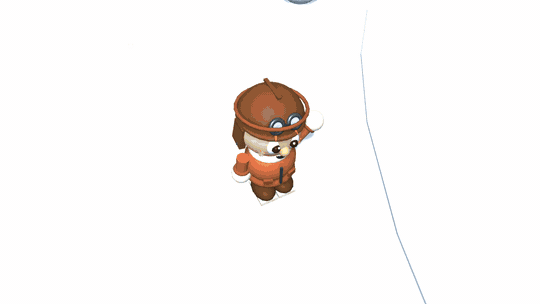

### Make them yours
On character select, **Customize** (Flipper, Parker and Tucker) opens a dressing room: start from an outfit, repaint every part
(jacket, hat or hair, scarf or bandana, pants, boots, gloves and more; Flipper's hair has its own palette of natural
shades) and add accessories. Flipper and Parker also have a **Face** tab: eyes, eyebrows and mouth styles, and switches for his
eye whites, eye shine, nose, freckles and blush (each On / Off), and a **Body type** choice: Stout (his own build) or Slender (Parker's proportions). Head: flaming head, party hat,
propeller cap, cat ears, halo. Face: shades, round specs, clown nose. Back: cape. Flipper and Parker share a few more:
Parker's winter hat and snowboard and Flipper's scarf (Neck), and "None" takes off even the ones they start with.
Headphones (Ears) for anyone; each accessory takes its own color. The **Wear** tab has the cap, goggles, shoes and
**hoodie**; **Undo** (or Z) and **Surprise me** sit under every tab. Flipper's goggles can come off, and everyone can wear a **hoodie** (regular or oversized, any color) over their outfit.
They move, too: the propeller spins faster as you run, flames flicker, hats and scarves swing, the hood bounces and the
cape streams.
Your look shows up for friends in multiplayer.

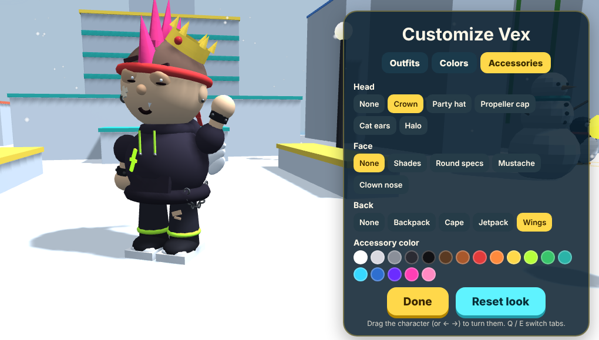

### Trick Park
Type **your name** on the character select screen: it's what friends see in multiplayer.
Maps to skate, flip and wall-jump around. **Free roam** has no lives: tricks, combos and **named gaps** earn trick
points (higher orbs are worth more there). Step on the PLAY pad to start a game: **Collectathon** (how many orbs can you
collect before time runs out?) is a straight count of orbs, **Snowball Wars** is hearts and KOs, and **Tag** is time spent It.
- **Plaza:** a skatepark built around trick lines: tower and crown, runway, chimney, pillars, treehouse, fountain, and the Big Slide.
- **Frozen Rink:** real ice physics: build speed, glide, drift and bounce off the boards.
- **Woodsy Cabin:** an old log cabin in a clearing ringed by thick pine forest. Start by a crackling campfire, climb
  the woodpile and porch onto the cabin roof and hop up the smoking chimney, leap from the treehouse onto the roof,
  take the stump stairs up to the hunter's lookout, bounce on the tents, and skate the frozen pond.
- **Jungle Gym:** one connected playground built to use every move: a two-level fort, tire run, fireman pole,
  monkey bars, Pound Peak, trampolines and a wall-jump canyon, with 12 named gaps.

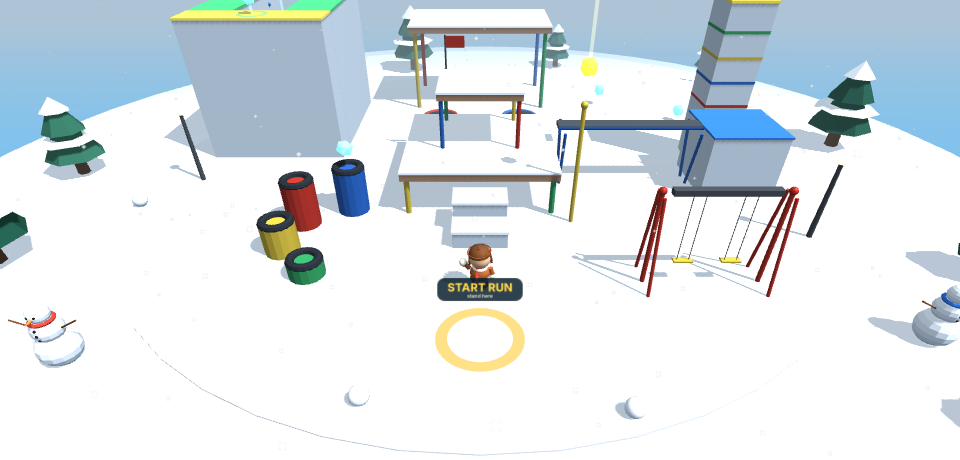

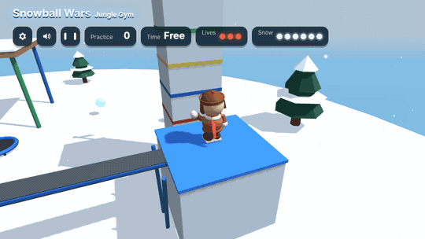

### Climb trees and poles
Run into a tree, lamp post or antenna to grab on, climb to a handstand, aim with the glowing arrow and flip off.

### Snowball fights
Knock down a snowman and it **drops a snowball pickup**: walk into it for 2 snowballs before it melts (15 s).
Throw snowballs (F / R1 / touch) at friends, snowmen and enemies. A hit knocks the target back and stuns it with
dizzy stars; orbs refill your snowballs. Turn on the **computer player** in Settings for someone to fight solo.
**Emotes:** standing on the ground, **tap** Ground pound (L1 / Q / right-click) for a quick taunt (your last emote,
Wave to start), or **hold** it: a ring fills, then the emote wheel opens. Point at one and let go (or click one, or 1-8): **Wave, Cheer, Robot, Shuffle, Disco,
Chicken Dance, Snow Angel, Yellow Snow**. Dances loop until you move, and friends see them. Yellow snow (optional
silliness, off in Settings; Parker doesn't) keeps spraying until you press Ground pound again, and leaves you a yellow snowball.

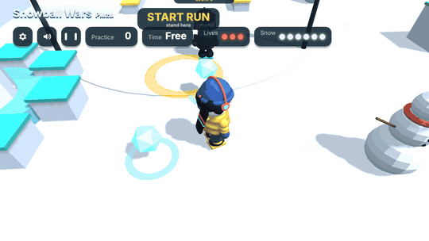

### Winter activities
- **Snow angels:** from the emote wheel, or Crouch + Ground pound while standing in snow. Lie back, sweep, leave an angel.
- **Rolling snowballs:** walk into one of the small snowballs around each Trick Park map to push it. It grows as it rolls,
  bowls over enemies and snowmen, and a big one is something to stand on. Smash it to start over.

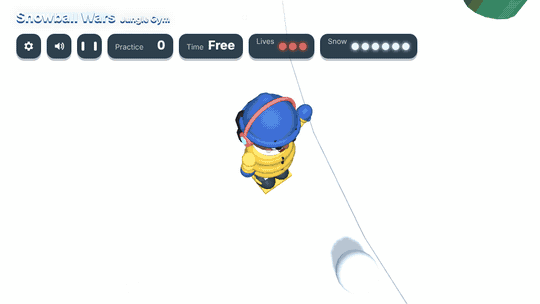

- **Butt slide:** hold Crouch on a slope, like the Big Slide in the Plaza, to sit down and slide. Steer with the stick,
  Jump to hop off with your speed.

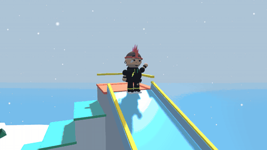

### The winter crew

- **Snow goons** keep their distance and lob snowballs.
- **Penguin sliders** flap a red "!" and belly-slide at you, then sit dizzy.
- **Holiday elves** steal your snowballs into their sacks; smack them before they escape.

Punch, kick, snowball, dive, ground-pound or **stomp** them, and dive or belly-slide straight into a snow goon for a **Dive Bomb**. Prefer the classics? Settings → Enemies → Spikeballs.

### Map Builder
Build your own Trick Park maps: Trick Park → **More maps & builder** (or **Map Builder** on the main menu).

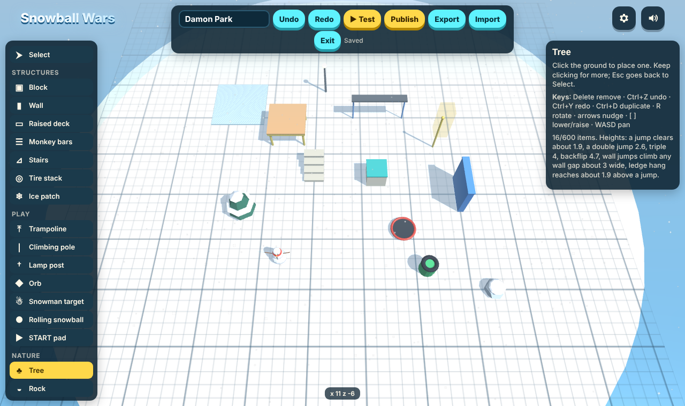

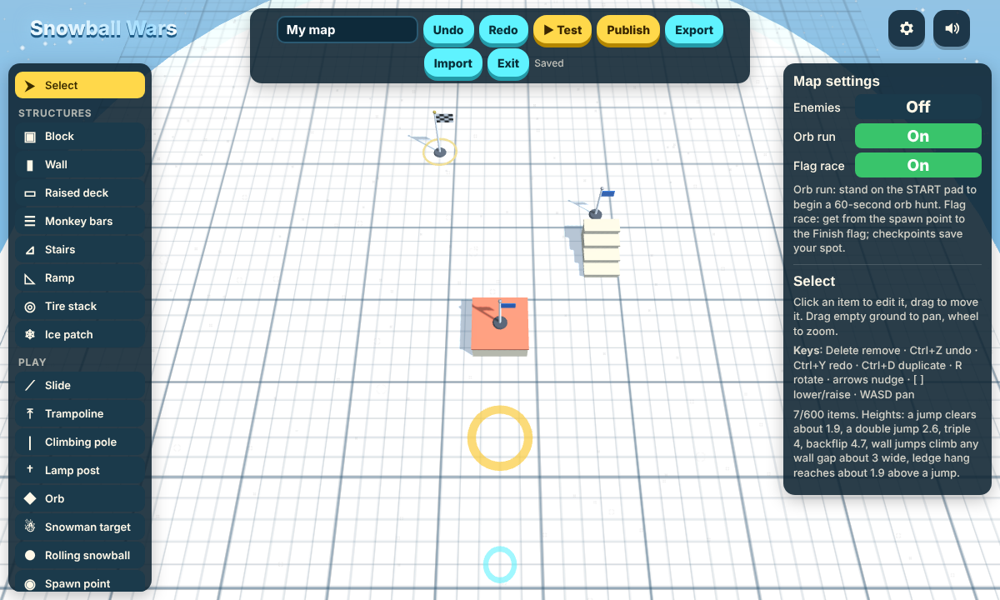

- **Asset library:** tabs (Structures, Play, Objectives, Nature, Village, City) and a search box, with a picture of
  every asset. Blocks, walls, raised decks, monkey bars, stairs, ramps, tire stacks, ice, slides, trampolines,
  climbing poles, trees, rocks, orbs, snowman targets, rolling snowballs, the spawn point, the START pad, checkpoint and
  finish flags, plus Christmas Village pieces (candy canes, Christmas trees, gift boxes, market stalls with bouncy
  awnings, cottages with walkable roofs, big baubles) and city pieces (skyscrapers, flagpoles with flags that blow in
  the wind, lamp posts). A see-through ghost of the asset follows the pointer before you place it.
- **Camera:** Top, Angled and Low views (V cycles), Q/E or the arrow buttons turn the view, right-drag orbits,
  F focuses on the selection.
- **Edit:** click to place, drag to move, then resize, raise, recolor, rotate, duplicate or delete in the inspector.
  Undo/redo, keyboard shortcuts, and drafts that save as you go.
- **Test:** play the map with the full moveset, then pause → Back to builder.
- **Map settings:** turn enemies, the orb run and the flag race on or off. Players appear at the **Spawn point**;
  the **START pad** begins the orb run; **Checkpoint** and **Finish** flags make a race with a saved best time.
- **Publish** (claude.ai version): the map joins the More maps list for everyone who opens the game.
  Anywhere else, **Export / Import** map files.

#### Dev Maps and User Maps
The Trick Park picker has two tabs (click them, or Q/E, or L1/R1 on a controller):
- **Dev Maps:** the maps that come with the game.
- **User Maps:** maps made by players, credited to their maker. That's maps shipped with the game (currently
  **Ben's Madness Map** by Ben) plus every map published from the builder (claude.ai version), newest first.
  A published map shows up for everyone right away; its maker or the game's owner can unpublish it from
  More maps & builder.

To ship a map with the game instead, Export it from the builder, then add the `.snowmap.json` contents to
`USER_MAPS` in `js/maps/user-maps.js` (set `name` and `author`).

### Day and night
Settings → **Time of day**: Always day, Always night, or Day & night (an eight-minute cycle with warm dusks and
dawns). Night brings out a moon and twinkling stars, and the lamps glow.

### Play your way
- **Multiplayer** (in the claude.ai version): play Trick Park with friends, with shared orbs and enemies, name tags and trick callouts.
- **Controls:** keyboard & mouse, PS5 / standard controllers, the Switch 2 Pro Controller and touch; rebind anything in Settings → Controls. Every menu works with a controller, with on-screen ✕ / △ / ○ / L1 / R1 prompts (B / X / A / L / R on a Switch 2 Pro).
- **Switch 2 Pro Controller (wired, Chrome or Edge on a computer):** it stays silent over USB until it's woken up, so the
  first time a small "Switch 2 Pro Controller found" button appears in the corner: click it and pick the controller.
  After that it wakes on its own whenever you load the game. A second, optional click turns on rumble.
- **Settings** in three tabs: **Game** (camera: Classic, Behind you, Free or Free + auto; graphics quality, performance stats, season, snowfall, side flip style, ledge hang, squash & stretch, yellow snow, enemies, computer player), **Sound** (volume mix and a style for every sound) and **Controls** (rebind anything).
- **Graphics: Auto** adjusts render resolution to hold a smooth frame rate (or pick High, Balanced or Low). Press **`** (backtick) for a performance overlay: fps, frame time, draw calls and GPU memory.
- **Pause** swings the camera round to face your character, who waves and idles beside the pause menu. **Edit character** there opens
  the customizer right where you're standing.
- **Tag**: pick Tag on the PLAY pad. Whoever's It wears an IT! sign; touch someone to pass it on. Least time as It after 2 minutes wins. Snowballs stun the It.
- **Friendly penguins**: they leave you alone until you hit one. Then it and its friends get angry.

  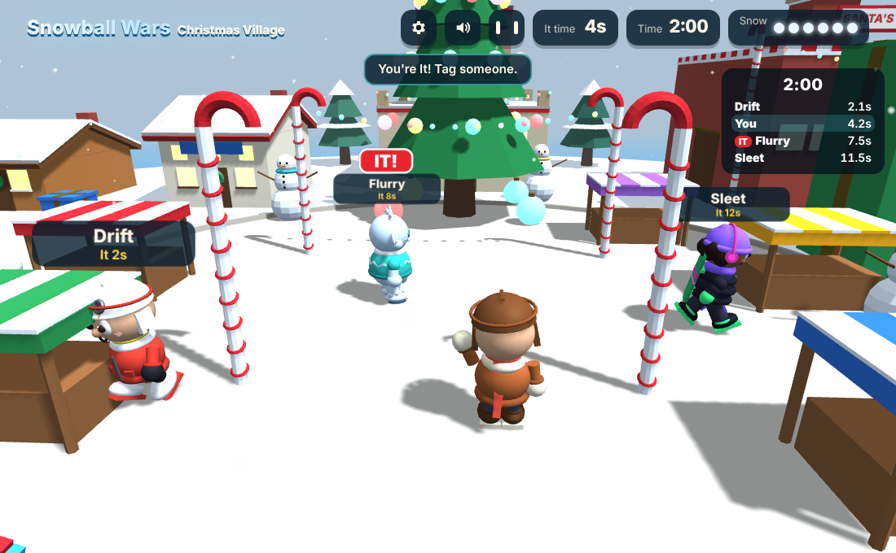

- **Christmas Village** (Trick Park map 5): a connected rooftop loop around a town square: climb the giant tree and flip onto the clock tower, wall-jump up Chimney Alley, long-jump to the pond island, and long-jump + dive off the sledding hill onto the rooftops.

  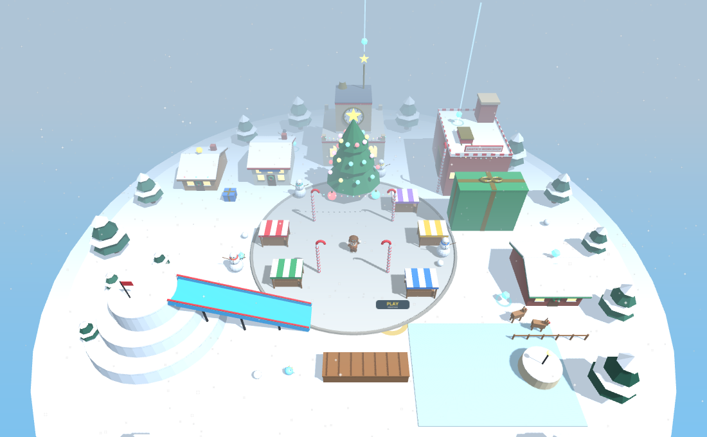

- **Collectathon** (formerly Orb Race): how many orbs can you collect before time runs out? Friends on the map join the same run; whoever grabs the most orbs wins (no points), a snowball hit knocks 2 of your orbs loose for anyone to grab; solo, two computer rivals race you (Settings → Collectathon rivals).

  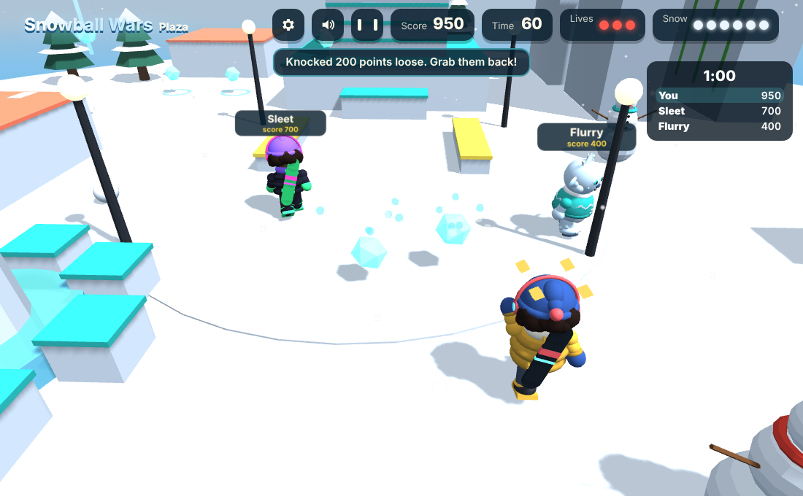

- **Aim and charge snowballs:** hold Throw (R1 / F / left-click / Snow) to see a dotted arc of where it will land;
  hold it a second and the arc turns gold. The arc stops at whatever the snowball would hit first (walls, trees,
  the ground) and turns **red with a ring at their feet** when a target is in its path (a player, rival, enemy, penguin
  or snowman). Let go for a **charged snowball**: double damage (2 hearts in Snowball Wars,
  twice the orbs knocked loose in a Collectathon) and a longer stun. A quick tap still throws straight away.
  With the mouse, Flipper turns toward the cursor while you aim (and a click throws right at it), even while running
  another way.
- **Snowball Wars mode**: pause in Trick Park and pick *Snowball Wars* for a 3-minute free-for-all. 3 hearts each, most KOs wins (no points), snowball pickups to grab (the high ones hold more). Solo you face three computer players; with friends on the map it's players only.
  **Power-ups** show up during a match: **Snowball Frenzy** sprays snowballs in every direction, and **Blitz** makes you
  invincible so anyone you touch goes down. Get two KOs within 10 seconds and **you're on Fire!**: every throw is charged.

  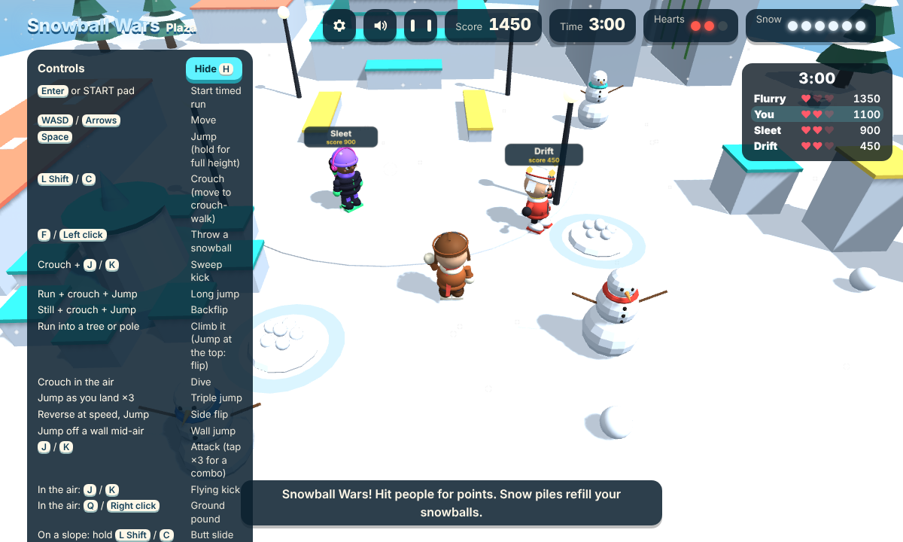

- **Orb style** (Settings → Game): swap the orbs for donuts, stars, snowflakes, presents or coins.

  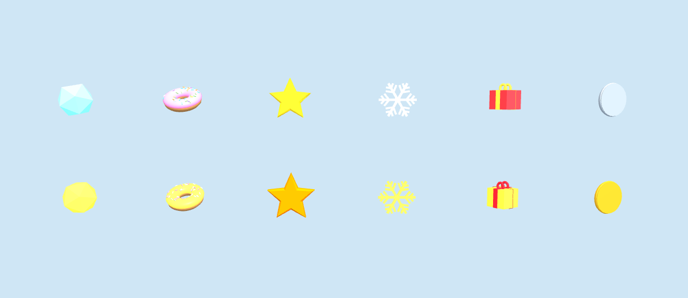
- **Hold to respawn** (L3 / R) takes you back to the spawn point or your last checkpoint; **hold to restart** (△ / Enter) restarts the orb run, race or level. A meter fills while you hold.
- **Moves** in the pause menu lists every move for the character you're playing. During an orb run the pause menu also has **Restart** and **Stop orb run**, and when a run ends you keep playing right where you are.

### Multiplayer on GitHub
The GitHub Pages copy has multiplayer too, with no server: browsers find each other through public Nostr relays
([Trystero](https://github.com/dmotz/trystero), MIT, loaded from a CDN and pinned to 0.25.2) and then connect directly.
- **Play together:** send friends the game's link. Everyone who opens it is in the public lobby; anyone on the same
  Trick Park map plays with you. Type your name on the character select screen so they know who you are.
- **Private group:** add `?room=` and any name to the link, e.g. `https://damonsea.github.io/snowball-wars/?room=bens-crew`.
  Only people with that exact link share a room.
- **Can't connect?** Some strict networks (school, work, hotel Wi-Fi, some phone networks) block direct connections.
  The fix is a TURN relay: get free credentials (e.g. Cloudflare Realtime TURN or Metered's Open Relay) and add them to
  `P2P.turn` at the top of `js/net/p2p.js`:
  `turn:[{urls:'turn:…',username:'…',credential:'…'}]`.
- The GitHub copy and the claude.ai copy are separate: players on one don't see players on the other.
- Publishing maps to User Maps needs claude.ai's database, so on GitHub, share maps by Export / Import instead.
- Test: `tests/p2p/p2p-check.py` runs two game windows against a stand-in for Trystero (see the file for how to run it).

## Project guide

(Formerly "Orb Run", then briefly "Frosty Falls". Saved data keeps its `orbRun…` storage keys so scores, gaps and unlocks carry over.)

A 3D browser game built on three.js r128. Flipper, a pint-sized stunt pilot, tricks his way
through Trick Park (its maps, free roam, game modes and multiplayer) and maps you build yourself.

## How the files fit together

The page loads plain scripts in order (see `index.html`). Each file can use anything defined
by files above it. Nothing is bundled.

| Order | File | What it does |
|---|---|---|
| 0 | `js/input/pads.js` | Switch 2 Pro Controller support, loaded before everything else: remaps it to the standard layout, wakes it over USB, rumble, player light, B / A / Y / X prompts |
| 1 | `js/tuning.js` | **Every gameplay number**: gravity, jumps, speeds, ice, climbing, attacks, combo, scoring, camera |
| 2 | `js/core.js` | Renderer, scene, lights, material helpers, season registry, trees/rocks/flowers |
| 3 | `js/characters.js` | Rigs and wardrobes for Flipper, Parker and Tucker (plus benched Sunny, Rook and Vex), spring physics for dangly bits, character table and roster |
| 4 | `js/fx.js` | Spikeball model, particle bursts, collision push-out |
| 5 | `js/audio/sfx.js` | Sound engine and the configurable sound-effect library |
| 6 | `js/audio/music.js` | Music tracks, ambience, spikeball rolling sound |
| 7 | `js/enemies.js` | Enemies: snow goons, penguin sliders, holiday elves (AI, stomps, theft) and the Spikeballs toggle |
| 8 | `js/levels/engine.js` | Map builders and collision queries (how to add maps is documented at the top) |
| 10 | `js/maps/*.js` | Trick Park maps: Plaza, Frozen Rink, Woodsy Cabin, Jungle Gym, Christmas Village |
| 11 | `js/content-ready.js` | Picks the current map once all are registered |
| 12 | `js/state.js` | Game state, HUD, menus, character select, pause |
| 13 | `js/trickpark.js` | Trick Park: START pad, combos, orbs, spikeballs, timed runs |
| 14 | `js/orbskins.js` | Orb styles: crystal, donuts, stars, snowflakes, presents, coins |
| 15 | `js/physics.js` | Platform physics, ice, walls, tree and pole climbing, ledge hang, trampolines, raised decks |
| 17 | `js/combat.js` | Three-hit combo, sweep, air kick |
| 18 | `js/movement.js` | Sunny/Rook controls and Flipper's whole moveset |
| 19 | `js/pound.js` | Ground pound for every character: spin, drop, shockwave |
| 20 | `js/input/bindings.js` | Custom controls: key, mouse and controller bindings, rebinding in Settings |
| 21 | `js/ui/settings.js` | Settings panel (season, time of day, mix, sound styles) |
| 22 | `js/ui/customize.js` | Customize screen: outfit presets, part colors, accessories (and their animations), saved looks |
| 23 | `js/ui/controls.js` | Controls card, keyboard, touch |
| 24 | `js/input/gamepad.js` | PS5 / standard controller support |
| 25 | `js/loop.js` | The frame loop: update, animate, camera, render |
| 26 | `js/seasons.js` | Snowfall, breath, Winter/Summer switching |
| 15b | `js/landing.js` | Ground spot: a disc straight under you while you're in the air |
| 26b | `js/daynight.js` | Day and night: sky, moonlight, moon and stars, the cycle (Settings → Time of day) |
| 27 | `js/net/p2p.js` | Multiplayer outside claude.ai: peer-to-peer stand-in for the room (Trystero) |
| 28 | `js/multiplayer.js` | Trick Park multiplayer over the page's room capability (or the P2P stand-in) |
| 29 | `js/snowballs.js` | Snowball fights: throwing, ammo (refilled by orbs), snowmen, hits on players (Trick Park only) |
| 30 | `js/wars.js` | Snowball Wars mode: matches, hearts, scoring, snow piles, computer players |
| 30b | `js/powerups.js` | Snowball Wars power-ups: Snowball Frenzy and Blitz pickups, You're on Fire! |
| 31 | `js/orbrace.js` | Orb Race: shared runs with friends, knocked-loose orbs, computer rivals |
| 32 | `js/tag.js` | Tag mode: It passing, no tag-backs, time-as-It scoring, computer players |
| 33 | `js/yellowsnow.js` | Yellow snow: spray stream (from the emote wheel) that marks the snow, yellow snowballs (Settings → Yellow snow) |
| 34 | `js/winterfun.js` | Snow angels and rolling snowballs that grow |
| 35 | `js/emotes.js` | Emote wheel (hold Ground pound standing): wave, cheer, dances, snow angel, yellow snow |
| 36 | `js/cpu.js` | Computer player for Trick Park (Settings → Computer player) |
| 37 | `js/builder/maps.js` | Map Builder asset library, map cleaning, and turning a saved map into a playable Trick Park map |
| 38 | `js/builder/editor.js` | Map Builder editor: camera views, tabbed library with asset pictures, ghost preview, placing, selecting, dragging, inspector, undo, test play |
| 39 | `js/builder/community.js` | Drafts, publishing to the shared map list, More maps panel, export and import |
| 40 | `js/qol.js` | Hold to respawn / restart, Stop orb run, Moves list in the pause menu |
| 41 | `js/main.js` | Startup |

## Tests

`tests/` holds a headless playthrough. `three-stub.js` stands in for three.js with real vector
math and no rendering; `run.py` (needs Python, Playwright and Chrome) loads the game, makes randomness,
frame timing and audio deterministic, plays a scripted session through every mode and records
game-state snapshots. Run it on two versions and compare the snapshots to prove a change didn't
alter gameplay: `python3 tests/run.py index.html out.json`.
The stand-in library is swapped in for the CDN copy of three.js automatically.

Note: the downloaded single page no longer runs on its own. Play from the artifact page.

`lines.py` checks map design with the real physics: it places Flipper at a spot, feeds frame-exact
inputs (held jumps, crouch timing, late dives, a wall-jump bot) and reports where he lands and which
named gaps fired. Use it whenever a map changes: each line should land, and each shortcut should not.

## Named gaps

A Trick Park map can list `gaps` in its `RUNMAPS` entry: `{name, pts, from:[regions], to:[regions]}`,
where a region is a box `{x,z,w,d,y}` at a surface height. Taking off from a `from` region and landing
in a `to` region without touching anything in between awards the gap into the combo. First discoveries
are saved per map and counted in the pause menu. Plaza has 13; Frozen Rink has none yet.

`procon-check.js` checks the Switch 2 Pro Controller layout, prompts and switching back to a DualSense. `snowballs-check.js`, `ammo-check.js`, `cpu-check.js`, `moves-check.js` and `nova-check.js` are quick checks of snowball hits, orb refills,
the computer player, and ground pound / rebinding / pole climbing: pass a file's contents as the second argument,
e.g. `python3 tests/lines.py index.html "$(cat tests/moves-check.js)"`.

